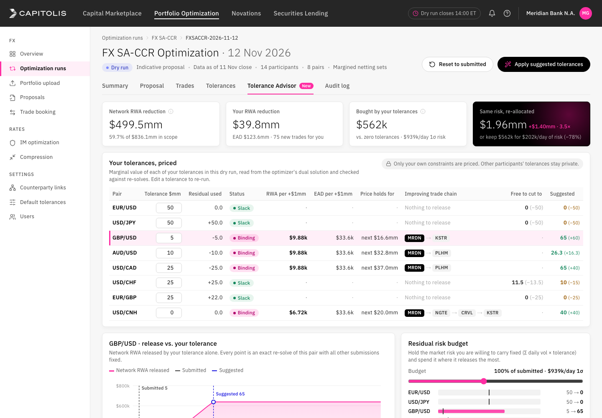

# Tolerance Advisor for multilateral FX SA-CCR optimization (Capitolis concept)

**Live demo:** https://mohith26.github.io/capitolis-tolerance-advisor/

Unofficial concept demo by Mohith Gajjela. Not affiliated with Capitolis. Synthetic data.

## What
In a multilateral optimization run, each participant submits private **tolerances**: how much net new position per currency pair it will accept from the risk-offsetting trades. After the dry run (indicative proposal) participants can revise them, but today they do it blind. Tolerance Advisor is a new tab in the run view that tells a participant, for its own constraints only:

1. **What each tolerance is worth right now**: network RWA (and EAD) released per extra $1mm, read from the optimizer's dual solution.
2. **Why**: the improving trade chain behind that price (you → counterparty → ... → the participant that absorbs the offsetting position inside its own tolerance), and how far the price holds before it steps down.
3. **What it can drop for free**: for slack tolerances, the smallest level that keeps the same optimum (exact re-solves, bisection).
4. **The release-vs-tolerance curve** for any pair (exact re-solve at 41 tolerance levels).
5. **A risk-budget re-allocation**: keep the market risk you carry fixed (Σ daily vol × tolerance) and move it to the pairs where it releases the most; or keep today's release at the least risk. Suggestions are re-solved end to end before they are shown.

In the seeded run, the viewing bank (MRDN) submits 50/50/5/10/25/25/25/0 across eight pairs. Its tolerances carry $939k/day of 1σ risk and buy $562k of network RWA. Re-allocating the same risk buys $1.96mm (3.5×), or today's $562k can be kept with $202k/day of risk (−78%). `node scripts/summary.mjs` prints these from the seeded data.

## How it works
- **SA-CCR, margined FX.** Per netting set and currency-pair hedging set, EAD contribution = 1.4 × 4% × MF 0.3 × |effective notional| (multiplier 1; RC unchanged because new trades are at market). RWA uses each side's counterparty risk weight, so a netting set's cost weight is the sum of both sides' weights.
- **Each currency pair is an exact min-cost flow.** Banks are nodes, netting sets are edges with convex piecewise-linear cost w·|a + x|, edge capacities are pair credit appetite, and each participant's tolerance is a capacitated arc to a residual-risk node (tiny penalty so tolerance is only used when it releases exposure). Solved by saturating negative-cost arcs and running successive shortest paths (Dijkstra with potentials).
- **Shadow price** of a tolerance = −(cost of the cheapest residual cycle through that tolerance arc), via Bellman-Ford on the optimal residual graph. That is the exact right-derivative of the optimum, and the cycle itself is the explanation and gives the step length (bottleneck).
- **Curves and budgets.** The optimum is concave in each tolerance (LP right-hand-side parametrics), so filling a risk budget greedily by release per unit of risk is exact on the grid, and the inverse problem (least risk for a target release) uses the same order.

## Tests
`node --test test/` (10 tests, no dependencies): a fully circular exposure compresses to zero; a two-party case with a closed-form shadow price; 60 random instances are feasible and optimal (no negative residual cycle, the min-cost-flow optimality certificate); dual shadow prices equal finite-difference slopes of the re-solved optimum (25 binding tolerances across random instances); curves are monotone and concave; the allocator respects the budget and never does worse than the submitted mix; trade chains start at the participant, follow real netting sets and end at a counterparty with room; the least-risk budget reproduces the current release; free-to-cut levels keep the optimum and anything lower loses value; the generator is deterministic.

## Honest limitations
- Synthetic run: 14 fictional dealers, 8 pairs, seeded generator in `core/advisor.mjs`. Real runs optimize IM, gross notional and several tenors at once; here new trades are single-tenor forwards and only SA-CCR RWA is optimized. With SIMM's cross-bucket correlations the per-pair flow structure would not hold, and prices would come from the production solver's duals instead.
- PFE multiplier fixed at 1; unmargined netting sets are out of scope.
- The LP has alternative optima, so how a network saving is split between participants ("your RWA") follows the solver's tie-breaking. Prices, curves and the network numbers are unique.
- A price leaks a little information (that some counterparty downstream has room), which is a privacy design question.
- **UI:** no screenshots of the logged-in Capitolis platform are public, so the shell follows the capitolis.com design system (header band #262626, reverse wordmark, magenta #FF2EA3 / plum #7A0949 / grey scale and 8px radii from the site's CSS variables). The brand font, Px Grotesk, is commercial, so IBM Plex Sans stands in. Nav labels and the run-page layout are a plausible reconstruction, not a copy.

## Novelty note
Capitolis, LSEG Post Trade Solutions (Quantile) and OSTTRA (triBalance/triReduce) publicly describe participants setting tolerances or risk constraints and reviewing dry runs. None of their public product pages, press releases or fact sheets describe pricing tolerances (shadow prices), release-vs-tolerance curves, or tolerance-budget re-allocation for participants. Internal tooling may exist unpublicized.
